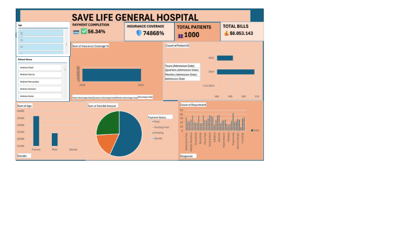

# Save Life General Hospital

### Patient Admission, Billing and Insurance Analysis Using Microsoft Excel

## Hospital Performance Dashboard

About the Project

This project is about using Microsoft Excel to study patient records at Save Life General Hospital.
It looks at patient visits, hospital bills, insurance and payment records.
I created a dashboard to make the information easier to understand and follow.

What I Wanted to Find Out

- How many patient visits were recorded?
- Which hospital departments had more patient visits?
- How much were patients billed?
- How long did patients stay in the hospital?
- What were the different payment statuses?
- How much insurance coverage was recorded?
- Which age groups had more patient visits?
- How did admissions and bills change over time?

About the Data

The dataset contains information about:

- Patient ID and name
- Age and gender
- Admission and discharge dates
- Hospital department
- Diagnosis
- Total bill amount
- Insurance coverage
- Payment status

Each row in the dataset represents one patient visit.

Tools Used

- Microsoft Excel
- PivotTables
- Charts
- Excel filters
- Dashboard design

What the Dashboard Shows

The dashboard gives a quick view of:

- Total patient visits
- Payment completion
- Insurance coverage
- Total hospital bills
- Patient admissions
- Payment status
- Patient age groups

Why This Project Is Useful

The dashboard helps to make hospital records easier to review.

It can help management see patient numbers, follow up on bills,
check payment records and understand insurance coverage.

KEY INSIGHTS

1. Patient Visits: Emergency recorded the highest visits (3,120),
2. followed by Cardiology (2,860), while General Medicine recorded the lowest (1,850).
3.  This indicates higher patient demand in Emergency and Cardiology.

4. Departmental Billing: Cardiology generated the highest bills ($1.86M),
5.  followed by Orthopedics ($1.62M).
6.  This highlights Cardiology as the leading department in billing.

7. Payment Status: 71.4% of bills were paid, while 15.2% remained pending and 13.4% partially paid.
8. Outstanding payments totalled $1,768,200, indicating a need for better payment collection.

9. Average Length of Stay: Cardiology recorded the longest average stay (4.8 days), followed by Orthopedics (4.2 days).
10. This may indicate more complex treatments or longer recovery periods.

11. Patient Age Groups: Adults aged 18–35 accounted for the largest share of visits (37.5%), followed by ages 36–50 (34%).
12.  This identifies younger adults as the largest patient group.

13. Admissions and Billing Trends: Monthly admissions and billing fluctuated throughout the year,
14.  with activity rising around the middle of the year. This highlights the importance of monitoring monthly performance.

RECOMMENDATIONS

1. Improve Payment Collection: Follow up on pending and partially paid bills to reduce outstanding payments.

2. Allocate Resources: Strengthen staffing and equipment in high-demand departments, particularly Emergency and Cardiology.

3. Review Patient Stays: Investigate longer stays in Cardiology to identify opportunities to improve patient care and discharge processes.

4. Strengthen Financial Monitoring: Regularly track outstanding bills and improve billing management.

5. Plan Healthcare Programmes: Develop appropriate healthcare services for major patient groups, especially adults aged 18–50.

6. Monitor Monthly Trends: Use admission and billing patterns to plan staffing, equipment and hospital resources.

CONCLUSION

The hospital dashboard provides useful insights into patient visits, departmental performance,
billing, payments and patient demographics.

The analysis reveals that Emergency recorded the highest patient visits,
while Cardiology generated the highest bills and had the longest average patient stay.

Although the payment rate reached 71.4%, the outstanding amount of $1,768,200 highlights the need for improved payment collection.

Overall, the project demonstrates how data analysis can support better hospital management, financial planning and healthcare service delivery.

